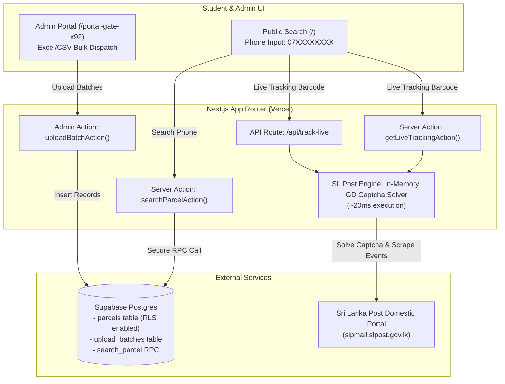

# 📦 A/L Mass Media – Tutes Delivery Tracking System
### සුරංග ගමගේ &bull; උසස් පෙළ ජනසන්නිවේදනය හා මාධ්‍ය අධ්‍යයනය

[](https://nextjs.org/)
[](https://www.typescriptlang.org/)
[](https://tailwindcss.com/)
[](https://supabase.com/)
[](https://vercel.com/)

A production-ready, ultra-secure, mobile-optimized Parcel Tracking Web Application tailored specifically for **Suranga Gamage Sir's Advanced Level Mass Media class ("A/L Mass Media - Suranga Gamage")**. Students use this portal to track the dispatch and real-time delivery status of their monthly theory and revision tute packs via **Sri Lanka Post (SL Post)** domestic postal network.

---

## 🌟 Key Features & Highlights

### 1. 🔍 Public Student Tracking (`/`)
- **Fast, Mobile-Friendly Lookup**: Students enter their mobile number to check tute dispatch status.
- **Smart Sri Lankan Number Parsing**:
  - Local format: `07XXXXXXXX`
  - International format: `+94XXXXXXXX` / `94XXXXXXXX`
  - Suffix / Partial Search: Any last 4 to 9 digits (e.g. `4047`).
- **Smart 3-Month Delivery History (Accordion)**:
  - Fetches the student's dispatch records for the **past 3 months** (e.g., `2026 නොවැම්බර්`, `2026 ඔක්තෝබර්`, `2026 සැප්තැම්බර්`).
  - **Latest Month (Default Expanded)**: Displays tracking barcode (`BG081146620LK`), copy code button, and triggers real-time SL Post delivery tracking.
  - **Previous Months (Collapsible Rows)**: Compact rows that expand on tap to load that month's specific delivery timeline.
- **Dual WhatsApp Support (Voice Call Protection)**:
  - Offline voice call numbers are protected by removing all phone call (`tel:`) triggers.
  - Dedicated direct WhatsApp action buttons linking to both class office admin lines:
    - **Admin 1**: `0789094047` (`https://wa.me/94789094047?text=...`)
    - **Admin 2**: `0710161699` (`https://wa.me/94710161699?text=...`)
  - Displays natural Sinhala notice card when a parcel is not yet handed over to post:
    > *"ඔබගේ පාර්සලය තවම Delivery එකට භාරදී නොමැත. කරුණාකර පහත අංකවලට WhatsApp පණිවිඩයක් යොමුකර විමසන්න."*

---

### 2. ⚡ In-Memory Sri Lanka Post Domestic Tracking Engine (`src/lib/slpost.ts`)
- **Reverse-Engineered Zero-Dependency Captcha Solver**:
  - Targets `https://slpmail.slpost.gov.lk/track/index.php`.
  - Solves the server-side PHP GD Font 5 (`gdfontg`) 5-character security captcha **in memory (~20ms)** using raw PNG chunk parsing and bitmask template matching against ASCII bitmaps.
  - No Puppeteer, Chromium, Python, or external OCR APIs required.
- **100% Natural Sinhala Event Mapping**:
  - Translates every raw postal milestone into native Sinhala:
    - `Receive item from customer` ➔ **පාර්සලය තැපැල් කාර්යාලයට භාරගැනීම**
    - `Send Item To Delivery Office` ➔ **බෙදාහැරීමේ කාර්යාලය වෙත යොමු කිරීම**
    - `Receive item at delivery office` ➔ **බෙදාහැරීමේ තැපැල් කාර්යාලයට ලැබීම**
    - `Handed over to post man` ➔ **ලියුම් බෙදුම්කරු වෙත භාරදීම**
    - `Item Delivered` ➔ **පාර්සලය සාර්ථකව භාරදෙන ලදී**
- **Status Badges**:
  - `Delivered` ➔ **භාරදී ඇත** (Emerald Green)
  - `Out for Delivery` ➔ **බෙදාහැරීමට රැගෙන යයි** (Amber)
  - `In Transit` ➔ **ප්‍රවාහනයේ පවතී** (Cyan)
  - `Dispatched` ➔ **තැපැල් කාර්යාලයට ලැබී ඇත** (Purple)
- **High-Performance Caching & Upstream Throttling**:
  - **5-Minute In-Memory Cache**: Repeated requests for the same barcode resolve in `0.01ms`.
  - **400ms Polite Throttle**: Prevents load spikes on government postal servers.

---

### 3. 🛡️ Data Privacy & Anti-Scraping Security
- **Row Level Security (RLS)**: Public `anon` role is strictly denied all direct `SELECT` queries on the `parcels` and `upload_batches` tables. Scrapers cannot crawl or dump the database.
- **Postgres Search RPC (`search_parcel`)**:
  - Built with `SECURITY DEFINER`.
  - Cleans and normalizes query input.
  - Masks phone numbers (`*******047`) to protect student identity.
  - Server actions rate-limit queries (20 requests/minute per client).

---

### 4. 📑 Hidden Admin Dispatch Portal (`/portal-gate-x92`)
- **Zero Public Navigation Links**: Hidden route accessible only via direct URL.
- **Hardened Passcode Gatekeeper**: Server-side verified session cookies with HMAC-SHA256 signature.
- **Structured Year & Month Batch Selectors**:
  - Year: `2025`, `2026`, `2027`, `2028`
  - Month: `ජනවාරි` to `දෙසැම්බර්`
  - Material Type: `නිබන්ධන (Tute Pack)`, `Revision Tutes`, `Past Papers`, `Model Papers`
  - Auto-constructs batch tag (e.g. `2026 නොවැම්බර් නිබන්ධන`) with a one-click *"Apply to all queued files"* button.
- **Dynamic Column Mapping Multi-File Uploader**:
  - Select and process 5 to 6 Excel (`.xlsx`, `.xls`) or `.csv` files simultaneously.
  - Auto-detects **Phone Number** and **Tracking Barcode** columns across varying headers.
  - Real-time chunked uploads (500 records/chunk) with progress tracking.
- **Batch Management**:
  - Overview of all batches with total counts and upload timestamps.
  - Single-click batch deletion (cascades to related parcels).
  - Purge data older than 30, 60, or 90 days.

---

## 🏗️ Technical Architecture



---

## 🛠️ Environment Variables

Create `.env.local` in development or add to your Vercel Project Settings:

```env
# Supabase Configuration
NEXT_PUBLIC_SUPABASE_URL=https://<your-project-ref>.supabase.co
NEXT_PUBLIC_SUPABASE_ANON_KEY=eyJhbGciOiJIUzI1NiIsInR5cCI6...
SUPABASE_SERVICE_ROLE_KEY=eyJhbGciOiJIUzI1NiIsInR5cCI6...

# Admin Security Gate (/portal-gate-x92)
ADMIN_PASSCODE=admin@track2026
ADMIN_SESSION_SECRET=your_super_secret_32_character_string_here

# Contact Support (WhatsApp Fallback)
ADMIN_WHATSAPP_NUMBER=94789094047
ADMIN_PHONE_NUMBER=0789094047
```

---

## 🗄️ Database Schema & SQL Migration

Run this migration directly in your Supabase SQL Editor:

```sql
-- Enable extensions
create extension if not exists "uuid-ossp";
create extension if not exists "pg_trgm";

-- 1. Upload Batches Table
create table if not exists upload_batches (
    id uuid primary key default uuid_generate_v4(),
    filename text not null,
    month_tag text not null,
    total_records integer not null default 0,
    uploaded_at timestamptz default now()
);

-- 2. Parcels Table
create table if not exists parcels (
    id uuid primary key default uuid_generate_v4(),
    batch_id uuid references upload_batches(id) on delete cascade,
    raw_phone text not null,
    clean_phone text not null,
    tracking_code text not null,
    month_tag text not null,
    status text default 'Dispatched',
    created_at timestamptz default now()
);

-- Indexes for ultra-fast phone lookups
create index if not exists idx_parcels_clean_phone on parcels(clean_phone);
create index if not exists idx_parcels_phone_trgm on parcels using gin (clean_phone gin_trgm_ops);
create index if not exists idx_parcels_created_at on parcels(created_at desc);

-- 3. Row Level Security (Deny direct public selects)
alter table upload_batches enable row level security;
alter table parcels enable row level security;

create policy "Deny public select on parcels" on parcels for select to anon using (false);
create policy "Deny public select on upload_batches" on upload_batches for select to anon using (false);
create policy "Allow service_role all on parcels" on parcels for all to service_role using (true) with check (true);
create policy "Allow service_role all on upload_batches" on upload_batches for all to service_role using (true) with check (true);

-- 4. Secure Search RPC Function (Safe Public Search)
create or replace function search_parcel(query_phone text)
returns table (
    tracking_code text,
    month_tag text,
    status text,
    masked_phone text,
    uploaded_at timestamptz
) 
language plpgsql
security definer
as $$
declare
    sanitized_query text;
begin
    sanitized_query := regexp_replace(query_phone, '[^0-9]', '', 'g');
    
    if length(sanitized_query) >= 9 then
        if sanitized_query like '94%' then
            sanitized_query := substring(sanitized_query from 3);
        elsif sanitized_query like '0%' then
            sanitized_query := substring(sanitized_query from 2);
        end if;
    end if;
    
    return query
    select 
        p.tracking_code,
        p.month_tag,
        p.status,
        concat('*******', right(p.clean_phone, 3)) as masked_phone,
        p.created_at as uploaded_at
    from parcels p
    where 
        p.clean_phone = sanitized_query
        or (length(sanitized_query) >= 4 and p.clean_phone like '%' || sanitized_query)
    order by p.created_at desc
    limit 5;
end;
$$;

grant execute on function search_parcel(text) to anon, authenticated;
```

---

## 🚀 Local Development & Deployment

### 1. Install Dependencies
```bash
pnpm install
```

### 2. Run Local Development Server
```bash
pnpm dev
```
- **Student Tracking**: [http://localhost:3000](http://localhost:3000)
- **Admin Dispatch Portal**: [http://localhost:3000/portal-gate-x92](http://localhost:3000/portal-gate-x92)

### 3. Production Build
```bash
pnpm build
```

### 4. Deploy to Vercel
1. Push this repository to GitHub:
   ```bash
   git push origin main
   ```
2. Import the project in [Vercel](https://vercel.com/new).
3. Add the Environment Variables under **Settings > Environment Variables**.
4. Click **Deploy**.

---

## 📜 License & Credits

Developed for **A/L Mass Media with Suranga Gamage** (සුරංග ගමගේ - උසස් පෙළ ජනසන්නිවේදනය හා මාධ්‍ය අධ්‍යයනය). All rights reserved &copy; 2026.
