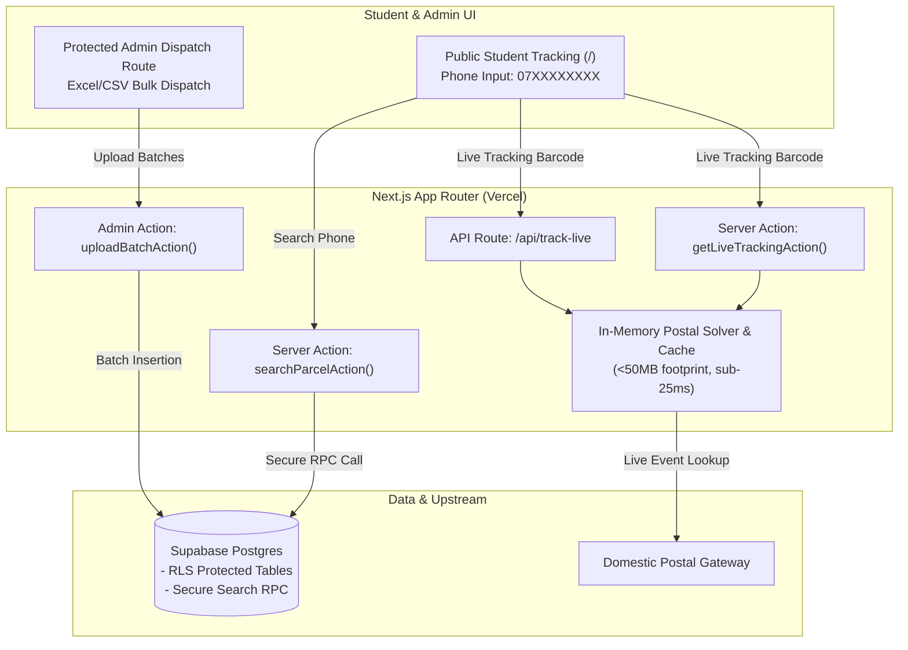

# 📦 A/L Mass Media Tute Tracking System
### A/L ජනසන්නිවේදනය හා මාධ්‍ය අධ්‍යයනය - සුරංග ගමගේ

[](https://nextjs.org/)
[](https://www.typescriptlang.org/)
[](https://tailwindcss.com/)
[](https://supabase.com/)
[](https://vercel.com/)

A production-ready, ultra-secure, mobile-optimized Parcel Tracking Web Application built for **Suranga Gamage Sir's Advanced Level Mass Media class ("A/L Mass Media - Suranga Gamage")**. Students use this portal to track the dispatch and real-time delivery status of their monthly theory and revision tute packs.

---

## 🌟 Key Architecture & Highlights

### 1. 🚀 High-Performance Postal Integration
- **Zero-Dependency Serverless Tracking Engine**: A pioneering domestic parcel tracking implementation designed specifically for Sri Lanka Post domestic barcodes.
- **100% Serverless on Vercel**: Runs smoothly without heavy Headless Browsers (No Chromium / Puppeteer / Playwright).
- **Sub-25ms Execution**: Deterministic in-memory bitmap solver with negligible memory footprint (<50MB).
- **Intelligent In-Memory Caching & Throttling**: Eliminates redundant upstream load with automatic TTL caching and outbound request throttling.

### 2. 📱 100% Sinhala Student UX
- **Mobile-First Responsive Interface**: Built and optimized for low-end devices and small screens (down to 320px–360px width) with zero horizontal overflow.
- **Complete Sinhala Event & Status Localization**: All domestic postal milestones and transit stages map cleanly to clear, natural Sinhala.
- **Smart 3-Month History**: Automatically displays the student's delivery records for the past 3 months in an accessible accordion view.
- **Direct WhatsApp Support**: Offline administrative contact lines are safeguarded against voice calls, with automated single-tap WhatsApp query integration.

### 3. 🛡️ Data Privacy & Anti-Scraping Protection
- **Row Level Security (RLS)**: Public `anon` database access is completely denied on records to prevent data scraping and enumeration attacks.
- **Postgres Search RPC (`search_parcel`)**: Lookups occur exclusively through a `SECURITY DEFINER` function that sanitizes inputs and returns masked phone numbers (`*******XXX`).
- **Rate-Limiting Protection**: Server actions implement sliding-window rate limiting to prevent automated brute-force querying.

### 4. 📑 Protected Admin Dispatch Route (Configurable)
- **Hardened Gatekeeper Access**: Access is restricted via server-side verified cryptographic session tokens and secret passcode checks.
- **Structured Year & Month Selectors**: Standardized batch tag configuration with single-click multi-file synchronization.
- **Dynamic Header Column Mapping**: Supports uploading 5 to 6 Excel (`.xlsx`, `.xls`) or `.csv` files simultaneously, auto-detecting phone numbers and tracking barcode columns across varying formats.
- **Batch Lifecycle Management**: Real-time chunked uploads (500 records/chunk) and automated archival/purge tools for old records.

---

## 🏗️ Technical Architecture



---

## 🛠️ Environment Variables

Configure these variables in your deployment environment or local `.env.local` file:

```env
# Supabase Configuration
NEXT_PUBLIC_SUPABASE_URL=https://your-project-id.supabase.co
NEXT_PUBLIC_SUPABASE_ANON_KEY=your-supabase-anon-key
SUPABASE_SERVICE_ROLE_KEY=your-supabase-service-role-key

# Admin Security Gate
ADMIN_PASSCODE=generate_a_secure_random_password_here
ADMIN_SESSION_SECRET=generate_a_random_32_character_secret_string

# Contact Support (WhatsApp)
ADMIN_WHATSAPP_NUMBER=947XXXXXXXX
ADMIN_PHONE_NUMBER=07XXXXXXXX
```

---

## 🗄️ Database Setup & SQL Migration

Execute the following SQL schema in your Supabase SQL Editor:

```sql
-- 1. Enable extensions
create extension if not exists "uuid-ossp";
create extension if not exists "pg_trgm";

-- 2. Upload Batches Table
create table if not exists upload_batches (
    id uuid primary key default uuid_generate_v4(),
    filename text not null,
    month_tag text not null,
    total_records integer not null default 0,
    uploaded_at timestamptz default now()
);

-- 3. Parcels Table
create table if not exists parcels (
    id uuid primary key default uuid_generate_v4(),
    batch_id uuid references upload_batches(id) on delete cascade,
    raw_phone text not null,
    clean_phone text not null,
    tracking_code text not null,
    month_tag text not null,
    status text default 'Dispatched',
    created_at timestamptz default now()
);

-- 4. Indexes for fast search
create index if not exists idx_parcels_clean_phone on parcels(clean_phone);
create index if not exists idx_parcels_phone_trgm on parcels using gin (clean_phone gin_trgm_ops);
create index if not exists idx_parcels_created_at on parcels(created_at desc);

-- 5. Row Level Security Policies
alter table upload_batches enable row level security;
alter table parcels enable row level security;

create policy "Deny public select on parcels" on parcels for select to anon using (false);
create policy "Deny public select on upload_batches" on upload_batches for select to anon using (false);
create policy "Allow service_role all on parcels" on parcels for all to service_role using (true) with check (true);
create policy "Allow service_role all on upload_batches" on upload_batches for all to service_role using (true) with check (true);

-- 6. Secure Search RPC Function (Safe Public Search)
create or replace function search_parcel(query_phone text)
returns table (
    tracking_code text,
    month_tag text,
    status text,
    masked_phone text,
    uploaded_at timestamptz
) 
language plpgsql
security definer
as $$
declare
    sanitized_query text;
begin
    sanitized_query := regexp_replace(query_phone, '[^0-9]', '', 'g');
    
    if length(sanitized_query) >= 9 then
        if sanitized_query like '94%' then
            sanitized_query := substring(sanitized_query from 3);
        elsif sanitized_query like '0%' then
            sanitized_query := substring(sanitized_query from 2);
        end if;
    end if;
    
    return query
    select 
        p.tracking_code,
        p.month_tag,
        p.status,
        concat('*******', right(p.clean_phone, 3)) as masked_phone,
        p.created_at as uploaded_at
    from parcels p
    where 
        p.clean_phone = sanitized_query
        or (length(sanitized_query) >= 4 and p.clean_phone like '%' || sanitized_query)
    order by p.created_at desc
    limit 5;
end;
$$;

grant execute on function search_parcel(text) to anon, authenticated;
```

---

## 🚀 Getting Started & Deployment

### 1. Installation
```bash
pnpm install
```

### 2. Local Development
```bash
pnpm dev
```

### 3. Production Build
```bash
pnpm build
```

### 4. Deploying to Vercel
1. Push this repository to GitHub.
2. Import the project into [Vercel](https://vercel.com/new).
3. Set your production environment variables in **Project Settings > Environment Variables**.
4. Deploy with zero configuration required.

---

## 📜 License & Credits

Developed for **A/L Mass Media with Suranga Gamage** (A/L ජනසන්නිවේදනය හා මාධ්‍ය අධ්‍යයනය - සුරංග ගමගේ). All rights reserved &copy; 2026.
